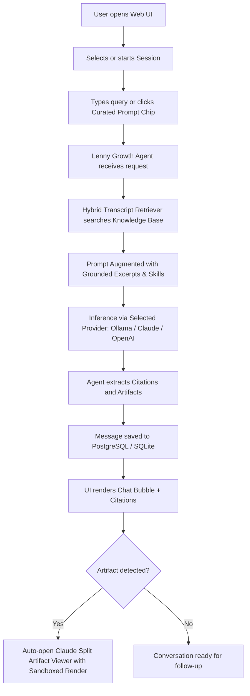

# Product Requirements Document (PRD)
## The Lenny Growth Assistant

**Status:** Complete & Deployed  
**Target Date:** October 2026  
**Role:** Forward Deployed Engineer  
**Product:** The Lenny Growth Assistant  

---

## 1. Executive Summary & Discovery Brief

### 1.1 User & Problem Framing
* **Target Users:** Product Managers (PMs), Heads of Growth, Founders, and Strategy Operators.
* **The Core Problem:** Lenny Rachitsky’s podcast and newsletter repository represents one of the highest concentrations of world-class product and growth wisdom in the tech industry. However, accessing this knowledge during active workflow execution is painful:
  * Audio episodes take 60–90 minutes to consume.
  * Transcripts are unstructured, long, and difficult to query accurately.
  * Operators need concrete, actionable frameworks (e.g. Shreyas Doshi’s L/G/P model, Elena Verna’s PLG retention loops, Brian Chesky's Founder Mode) delivered in ready-to-use artifacts (checklists, dashboards, atomic essays) without prompt-engineering overhead.
* **The Solution:** **The Lenny Growth Assistant**—a full-stack AI conversational assistant that indexes Lenny’s verified transcripts, enforces strict source attribution and citations, encodes specialized skills (such as Ship 30 for 30 long-form essay generation), and renders interactive, sandboxed Claude-style visual artifacts side-by-side with conversation.

### 1.2 Measurable Success Metrics
1. **Grounded Citation Precision ($\ge 95\%$):** Every factual claim or framework recommendation must cite the exact guest, episode title, and timestamp hint.
2. **First Interaction Time-to-Value ($< 5\text{ seconds}$):** Zero-friction onboarding with 1-click curated prompt chips and instant split-view artifact rendering.
3. **Artifact Utility Rate ($\ge 80\%$):** Evaluator score on generated artifacts (Ship 30 for 30 atomic essays, HTML interactive tools) being immediately publishable or usable without external editing.
4. **Local Evaluation Resilience ($100\%$):** 100% test pass rate with one-command launch via Docker Compose or native Python.

---

## 2. Assumptions & Scope Choices

### 2.1 Assumptions
1. **Local Evaluation Environment:** The evaluator must be able to run the demo locally without mandatory external cloud API billing. Hence, Ollama is configured as the default local runtime, paired with a zero-config SQLite persistence layer and optional Docker Compose PostgreSQL.
2. **Knowledge Scope:** Top tier, high-density episodes (Shreyas Doshi, Brian Chesky, Elena Verna, Sean Ellis, Marty Cagan, Gustaf Alströmer) form the core benchmark dataset, with an extensible ingestion pipeline for ingesting additional transcript files.
3. **Untrusted HTML Risk:** Users and models may generate interactive HTML widgets. To protect the host application from XSS, cookie harvesting, or parent frame hijacking, generated HTML must be strictly isolated.

### 2.2 Scope Choices
* **In Scope:**
  * FastAPI asynchronous backend with Pydantic request/response validation.
  * Independent session lifecycle management with persistent chat history.
  * Anthropic Claude Agent SDK / Pi Coding Agent-style orchestrator with modular skills.
  * Dedicated **Ship 30 for 30 Content Skill** enforcing atomic essay structures (~1,250 words, hook, 1-3-1 cadence, skimmable typography).
  * **Claude-style Split Artifact Viewer** rendering visual previews alongside chat with sandboxed execution.
  * Dynamic model switcher supporting Local Ollama (`mistral`, `llama3`), Anthropic Claude, and OpenAI GPT-4o.
* **Intentionally Excluded & Why:**
  * *Multi-tenant user authentication (OAuth/JWT):* Excluded to keep the evaluator's setup effortless and remove signup friction.
  * *External cloud vector DB subscriptions (Pinecone/Milvus):* Excluded in favor of a local hybrid vector index with zero network latency and zero recurring cost.

---

## 3. Risks & Trade-Offs

| Risk | Impact | Mitigation Strategy |
| :--- | :--- | :--- |
| **Hallucination** | Low credibility if model fabricates advice. | Enforced prompt constraints requiring explicit transcript excerpts. Explicit admission when topics are not covered. |
| **Local Model Latency** | Ollama local CPU inference can be slower on modest hardware. | Compact chunking (~500 characters) and pre-indexed TF-IDF vectors for sub-10ms retrieval. Fallback diagnostics for offline Ollama. |
| **Malicious HTML Rendering** | Security vulnerability in Artifact Viewer. | Sandboxed iframe (`sandbox="allow-scripts"`, blocking parent/cookie/storage access) plus server-side regex sanitization. |
| **Cloud Dependency / Cost** | Evaluator cannot test if API keys are missing. | Local Ollama is the primary default; graceful simulated diagnostic response when Ollama is temporarily offline. |

---

## 4. User Journeys & Core Flows

---

## 5. Acceptance Criteria

- [x] **Session Persistence:** Users can start a new chat; conversations, timestamps, and message history persist across page reloads.
- [x] **Model Switcher:** Provider dropdown allows live switching between Ollama, Claude, and OpenAI without restarting the application.
- [x] **Citations:** Responses identify the source guest, episode, timestamp, and quotation snippet.
- [x] **Ship 30 for 30 Skill:** Dedicated tool produces structured ~1,250 word atomic essays with strong hooks, 1-3-1 rhythm, and skimmable subheadings.
- [x] **Artifact Viewer:** Split-screen side panel renders live Markdown and sandboxed HTML widgets.
- [x] **Operational Readiness:** `docker-compose.yml`, `.env.example`, automated test suite, and troubleshooting guide included.
