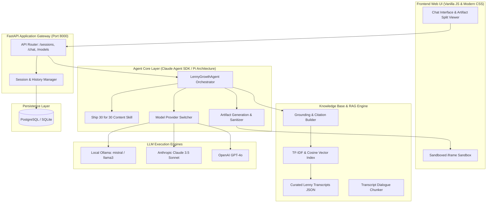
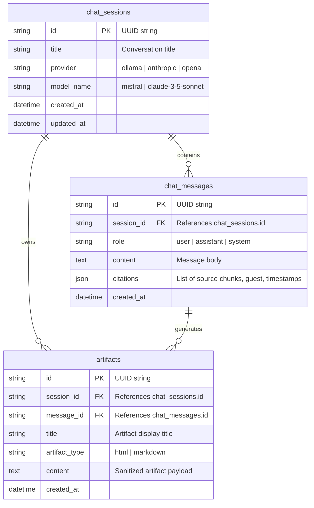

# Architecture Specification (architecture.md)
## The Lenny Growth Assistant

**System Type:** Full-Stack Agentic Conversational AI & Artifact Engine  
**Backend:** FastAPI (Python 3.11)  
**Database:** PostgreSQL 16 (Async SQLAlchemy / Asyncpg) with zero-config SQLite Fallback  
**Vector Index:** Hybrid Scikit-Learn TF-IDF & Cosine Similarity Knowledge Engine  
**LLM Providers:** Local Ollama (`mistral`, `llama3`), Anthropic Claude (`claude-3-5-sonnet`), OpenAI (`gpt-4o`)  

---

## 1. System Topology & Component Boundaries



---

## 2. Database Schema

The relational schema is defined via SQLAlchemy 2.0 Async ORM in [src/database/models.py](file:///D:/Spark%20studios/2026%20projects/rag-project/src/database/models.py):



---

## 3. Ingestion & Retrieval Pipeline

1. **Ingestion (`src/knowledge/ingestion.py`):**
   - Transcripts from `data/transcripts/` are loaded with rich episode metadata (Guest, Role, Episode #, Date, URL, Topics).
   - Text is split preserving speaker dialogue turns and timestamp annotations (`[00:02:10]`).
   - A TF-IDF vector matrix is fitted on the corpus and persisted in `embeddings/index.pkl` for rapid sub-5ms cold starts.
2. **Retrieval & Grounding (`src/knowledge/retriever.py`):**
   - Query vectors are scored against chunk vectors via cosine similarity.
   - Top-$k$ chunks above similarity threshold ($0.02$) are extracted.
   - Context is injected into the LLM system prompt alongside structured citation envelopes.

---

## 4. Agent Routing & Tool Architecture

The agent orchestrator (`src/agent/core.py`) evaluates incoming prompts against specialized skills:
* **Default Grounded QA:** Uses system prompt grounding constraints to synthesize advice strictly with guest attribution.
* **Ship 30 for 30 Skill (`src/agent/skills/ship30_skill.py`):** Dynamically activates when prompt requests an essay, newsletter, or Ship 30 format. Injects the hook, 1-3-1 cadence, skimmable bolding, and narrative arc rules.
* **Artifact Skill (`src/agent/skills/artifact_skill.py`):** Instructs model to encapsulate documents or HTML/CSS widgets inside `<artifact identifier="..." type="markdown|html" title="...">` tags. Extracts and passes them to the API response.

---

## 5. Security & Isolation Model

Because the assistant produces executable HTML/CSS code on demand, security isolation is paramount:
1. **Frontend Isolation:** Artifacts are injected into an `<iframe>` configured with:
   ```html
   <iframe sandbox="allow-scripts" ...>
   ```
   *Notice:* The `allow-same-origin` token is intentionally **omitted**. This prevents the sandboxed document from accessing `window.parent`, localStorage, sessionStorage, or host cookies.
2. **Backend Sanitization:** Server-side regex in `ArtifactSkill.sanitize_html` strips dangerous tokens (`parent.`, `top.location`, `document.cookie`).

---

## 6. API Contracts

| Method | Endpoint | Description |
| :--- | :--- | :--- |
| `GET` | `/api/health` | Healthcheck, database status, loaded chunks count, active provider. |
| `GET` | `/api/models` | List active provider, model name, and available alternatives. |
| `POST` | `/api/models` | Dynamically update active LLM provider (`ollama`, `anthropic`, `openai`). |
| `GET` | `/api/sessions` | List recent conversation sessions sorted by recency. |
| `POST` | `/api/sessions` | Create a new isolated chat session. |
| `GET` | `/api/sessions/{id}` | Retrieve complete conversation history and artifacts for a session. |
| `DELETE` | `/api/sessions/{id}` | Permanently delete a session and cascading messages/artifacts. |
| `POST` | `/api/chat` | Main agent query endpoint; returns answer, citations, and artifacts. |
